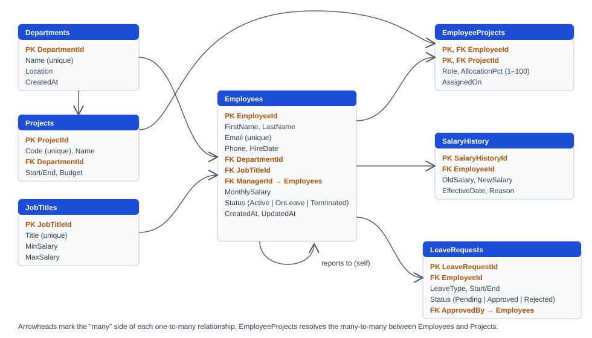

# SQL Server HR Database – Database Management Demonstration

> **Independent learning project.** I built this to practise and demonstrate SQL Server database design and T-SQL. It is **not** work from a previous employer, and all data is fictional.

A small but complete HR database for SQL Server: a normalised schema with primary, foreign, unique and check constraints, realistic sample data, reusable views, stored procedures for CRUD and business rules, documented example queries, and an automated test suite. The suite runs against a real **SQL Server 2022** container in GitHub Actions on every push.



## Objectives

- Design a relational schema with clear entities, relationships and constraints
- Write correct, readable T-SQL: joins, aggregation, window functions, CTEs, paging
- Encapsulate CRUD and business rules in stored procedures with proper error handling and transactions
- Prove it works with repeatable automated tests

## Technology

- Microsoft SQL Server 2019+ (tested on SQL Server 2022 in CI)
- T-SQL, `sqlcmd`
- GitHub Actions with the official `mcr.microsoft.com/mssql/server:2022-latest` image

## Schema

| Table | Purpose | Key relationships |
|---|---|---|
| `Departments` | Organisation units | – |
| `JobTitles` | Titles with a salary band (`MinSalary`–`MaxSalary`) | – |
| `Employees` | Staff records | FK → `Departments`, `JobTitles`; self-FK `ManagerId` → `Employees` |
| `Projects` | Projects owned by a department | FK → `Departments` |
| `EmployeeProjects` | Many-to-many assignments with role and % allocation | Composite PK; FKs → `Employees`, `Projects` (cascade) |
| `SalaryHistory` | One row per salary change | FK → `Employees` (cascade) |
| `LeaveRequests` | Annual/sick/unpaid leave with approval | FK → `Employees` (cascade); `ApprovedBy` → `Employees` |

Constraints include unique email, valid status values, positive salaries and budgets, valid date ranges, allocation between 1 and 100%, and "an employee cannot be their own manager". Indexes support the common lookups (department, manager, name, project).

## Views

| View | What it returns |
|---|---|
| `vw_EmployeeDirectory` | Employee, department, job title, manager name (self-join), years of service |
| `vw_DepartmentHeadcount` | Active headcount, payroll and average salary per department (keeps empty departments) |
| `vw_ProjectStaffing` | Team size, full-time equivalents and status per project |

## Stored procedures

| Procedure | Operation | Rules enforced |
|---|---|---|
| `usp_Employee_Create` | Create | Department exists, email unique, salary within the job-title band; returns the new ID |
| `usp_Employee_GetById` | Read | Returns the employee plus their project assignments (two result sets) |
| `usp_Employee_Search` | Read | Optional text, department and status filters with `OFFSET/FETCH` paging and a total count |
| `usp_Employee_Update` | Update | Not their own manager; "not found" error |
| `usp_Employee_Delete` | Delete | Blocked while they still have direct reports; cascades assignments, history and leave |
| `usp_Employee_ChangeSalary` | Update | Within band; updates salary and writes history in one transaction |
| `usp_LeaveRequest_Decide` | Update | Only pending requests; only the employee's manager can approve or reject |
| `usp_Department_Summary` | Report | Headcount, payroll and project count per department |

Procedures raise clear errors with `THROW` (50001–50007, 50404). Multi-statement changes run in a transaction, or in a savepoint when the caller already has one, so a failure never leaves partial data or dooms the caller's transaction.

## Folder structure

```
├── sql/
│   ├── 01_schema.sql       # database, tables, keys, constraints, indexes (re-runnable)
│   ├── 02_seed.sql         # fictional sample data: 6 departments, 10 job titles, 40 employees, 7 projects
│   ├── 03_views.sql
│   ├── 04_procedures.sql
│   └── 05_queries.sql      # 10 documented example queries
├── tests/run_tests.sql     # 13 automated checks, rolled back after running
├── docs/
│   ├── queries.md          # what each example query shows and why
│   └── er-diagram.svg
└── .github/workflows/sql-tests.yml
```

## Setup

You need SQL Server 2019 or later (Developer or Express edition, or Docker) and `sqlcmd` or SQL Server Management Studio / Azure Data Studio.

**With Docker:**

```bash
docker run -e ACCEPT_EULA=Y -e MSSQL_SA_PASSWORD='Your_Strong_Passw0rd' -p 1433:1433 -d mcr.microsoft.com/mssql/server:2022-latest
```

**Build the database** (run in order):

```bash
for f in sql/01_schema.sql sql/02_seed.sql sql/03_views.sql sql/04_procedures.sql; do
  sqlcmd -C -S localhost -U sa -P 'Your_Strong_Passw0rd' -b -I -i "$f"
done
```

In SSMS, open each file in the same order and execute it (F5).

**Run the tests:**

```bash
sqlcmd -C -S localhost -U sa -P 'Your_Strong_Passw0rd' -b -I -i tests/run_tests.sql
```

Each test prints `PASS`/`FAIL`; any failure raises error 50999 so `sqlcmd -b` exits with a non-zero code. All test changes are rolled back.

## Testing in CI

`.github/workflows/sql-tests.yml` starts SQL Server 2022 as a service container, runs every script and the tests, then runs the build a second time to prove the scripts are re-runnable.

## Example queries

See [`docs/queries.md`](docs/queries.md) for explanations. Highlights:

```sql
-- Salary rank within each department (window function)
SELECT Department, FullName, MonthlySalary,
       RANK() OVER (PARTITION BY Department ORDER BY MonthlySalary DESC) AS SalaryRank
FROM dbo.vw_EmployeeDirectory
WHERE Status <> 'Terminated';
```

## Limitations

- Learning project: no row-level security, auditing triggers, temporal tables or partitioning.
- Salaries are stored as monthly AED amounts without currency handling.
- The sample data is small and fictional; performance tuning is limited to sensible indexes.

## Licence

MIT, see [LICENSE](LICENSE).
